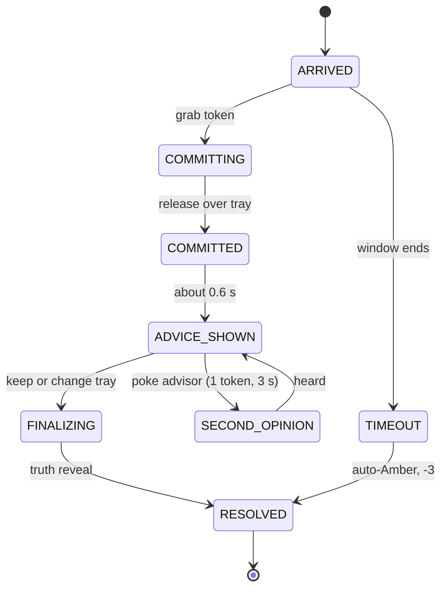

# 02 · Game design document (GDD)

Numbers here are **verified by `core-spec` tests**. Tuning values live in `data/*.json`, never hard-coded.

## 1. Fantasy and feel

You run a quiet night ward from your own table. Calm, tactile, a little tense. Three advisors murmur beside you. The decision is yours. **Feel pillars:** (1) *a stamp that feels good*, (2) *a reveal that makes you wince or grin*, (3) *an honest mirror at the end*.

## 2. The table (layout, all within 60 cm reach)

```
            back edge (about 45 cm from player)
   [Dash]  [Sage]  [Ledger]  [Orator]      <- advisor rail (faces player)
 ----------------------------------------
   Arrival lane        |  [RED] [AMBER] [GREEN]   <- three trays, shape-coded
   (tokens queue)      |   triangle diamond circle
 ----------------------------------------
        [ vitals card ]     [ verify tokens + clock + score ]   <- near edge, tilted toward player
```

| Element | Size | Notes |
|---|---|---|
| Ward diorama | about 60 × 40 cm | Anchored to the real table plane, or a virtual table |
| Trays | about 11 cm square | Triangle / diamond / circle plus colour |
| Patient token | about 5 cm | Low-poly abstract figure, easy to grab |
| Vitals card | about 14 × 10 cm | Tilted about 30° toward the player |
| Advisor rail | about 40 cm wide | Each advisor is a small character on a plinth with a badge |

## 3. Core loop (per patient)



| State | Rule |
|---|---|
| ARRIVED | Token on the arrival lane, window timer running (50 s, 38 s in a surge) |
| COMMITTING | Token held. Trays highlight. **No advice visible anywhere** |
| COMMITTED | Call locked. Stamp sound and tray glow |
| ADVICE_SHOWN | Lead advisor's call and line visible. Other advisors available to poke |
| SECOND_OPINION | A chosen advisor speaks. Costs 1 token and 3 s of shift clock. Disabled at 0 tokens |
| FINALIZING | Keep (do nothing / confirm) or drag to a different tray |
| RESOLVED | Truth tray glows, `whyLine` shown, score delta toast, log written |

**Commit feel (juice list):** token snaps with a small overshoot, short stamp haptic-style sound, ring pulse on the tray, brief hold before the advisor line appears (the 0.6 s beat builds tension).

## 4. Scoring (see `core-spec/src/scoring.js`)

| Result | Points |
|---|---|
| Correct tray | +10, plus speed bonus +3 (≤ 8 s), +2 (≤ 15 s), +1 (≤ 25 s) |
| One tray off | −5 |
| Two trays off (Red vs Green) | −15 |
| No commit in the window | auto-Amber scored normally, then −3, no speed bonus |
| Unspent verify token at shift end | +1 each (rewards restraint) |

**Calibration index** = (switch-right + hold-right) ÷ (switch-right + hold-right + switch-wrong + hold-wrong), 0 to 100. Only cases where the lead advisor's call differs from your committed call count. "Agree", "both wrong" and "third tray" cases are logged but excluded. Needs at least 4 disagreements, otherwise "not enough data".

| Reliance class | You did | Who was right |
|---|---|---|
| switch-right | Changed to the advice | The advice |
| hold-right | Kept your call | You |
| switch-wrong | Changed to the advice | You |
| hold-wrong | Kept your call | The advice |

**Over-reliance rate** = switch-wrong ÷ (switch-wrong + hold-right). **Under-reliance rate** = hold-wrong ÷ (hold-wrong + switch-right).

## 5. Advisors (hidden reliability, never shown to the player)

| Advisor | Style | Cardiac | Breathing | Injury | Children | Infection | Errors |
|---|---|---|---|---|---|---|---|
| **Dash** | Fast pattern-matcher | .92 | .90 | .88 | .55 | .80 | Off by one tray |
| **Sage** | Cautious, rarely misses red, over-calls | .85 | .85 | .85 | .85 | .85 | Upgrades (Green→Amber, Amber→Red). Red cases ≥ .97 |
| **Ledger** | Specialist | .96 | .60 | .55 | .50 | .58 | Off by one tray |
| **Orator** | Eloquent, confident, barely better than a coin flip | .55 | .55 | .55 | .55 | .55 | Off by one tray. Long confident explanations |
| *Echo* (stretch) | Mirrors your commit | n/a | n/a | n/a | n/a | n/a | Always agrees with you |

Each advisor has a recognisable voice and a badge. **Orator** teaches that *fluency is not accuracy*: it talks the most and is right the least.

## 6. Verify budget

Four tokens per module-3 shift (6 in module 2, none in module 1). Spending one means choosing *which* advisor to ask and *when*. Unspent tokens are rewarded. The debrief reports **verify yield**: the share of spent tokens that revealed a disagreement or fixed a wrong call.

## 7. Drift

At patient 9 of 14 one advisor's reliability on one category drops by **0.35**. The chosen advisor is strong in that category (≥ .85) and leads at least one later patient (the director enforces this). A subtle **"update installed"** cue appears on that advisor's badge, easy to miss, like real release notes. The debrief reports whether the player **noticed** (stopped following that advisor's wrong calls) or **missed** it.

## 8. Shift shape (module 3)

| Setting | Value |
|---|---|
| Patients | 14: 4 Green, 6 Amber, 4 Red |
| Pace | One arrival every 28 to 38 s, surges at patients 6 and 11 (arrive 4 s apart, shorter 38 s windows) |
| Ramp | First 3 patients are never borderline |
| Length | 6:36 to 7:26 in simulation, average 7:03. Hard cap 8:00 |
| Cases | Drawn by seed from the 60-case pool, at least 4 categories |

## 9. Modules (the course)

| Module | Name | Adds | Pass condition (tunable) |
|---|---|---|---|
| 1 | Commit First | Commit-first, Dash only, 6 patients | Finish the guided shift and see your first index |
| 2 | Read the Tells | Ledger, verify tokens (6), 10 patients, trust map | Index ≥ 65 |
| 3 | Pressure and Drift | Sage, Orator, surges, drift, 14 patients, 4 tokens | Index drop ≤ 10 vs module 2 |
| Roadmap | The Flatterer | Echo | Spot Echo within 5 cases |

## 10. Debrief (see `data/debrief-lines.json`)

Order on screen: **headline** (balanced / over-reliance / under-reliance / mixed / not enough data) → **Calibration index** with over and under rates → **1 to 3 findings** (advisor patterns, drift noticed or missed, verify yield, surge accuracy) → **one next step** → **trust map**. Tone rules: name the behaviour, not the person. Pair every observation with a next step. Never scold. No medical claims.

## 11. Progression and return

Daily seeded shift. Local streak and personal-best index. Trust map improving across shifts. Unlocks: Orator at module 3, Echo on roadmap. Everything stored locally with safe fallback.

## 12. Art and audio direction

| Area | Direction |
|---|---|
| Style | Low-poly diorama, flat colours, soft ambient light, one cohesive palette (calm blues, warm accent for the stamp) |
| Colour use | Red / Amber / Green are always paired with a shape. Keep the rest muted so zones pop |
| Characters | Abstract figures. No faces that resemble real people. Advisors are simple creatures or devices with distinct silhouettes and badges |
| Passthrough | The real table is the ward. Soft shadow blob under objects, no heavy VFX |
| Sound | Stamp, tray chime, token pickup, advisor voices as short synthesized motifs (one per advisor), reveal sting (right / wrong), ambient hum. Every cue has a visual twin |
| UI text | Short. Large. One line at a time during onboarding |

## 13. Interaction summary (full detail in `04-interaction-and-accessibility-spec.md`)

Grab and release to commit. Poke to read and to verify. Wrist menu to pause. Gaze-dwell as an alternative to every action. One-hand mode.

## 14. What success feels like

A judge commits a call, sees an advisor disagree, hesitates, changes their mind, and learns the advisor was wrong. Within five minutes they say something like *"oh, I trusted the wrong one."* That is the whole game.
